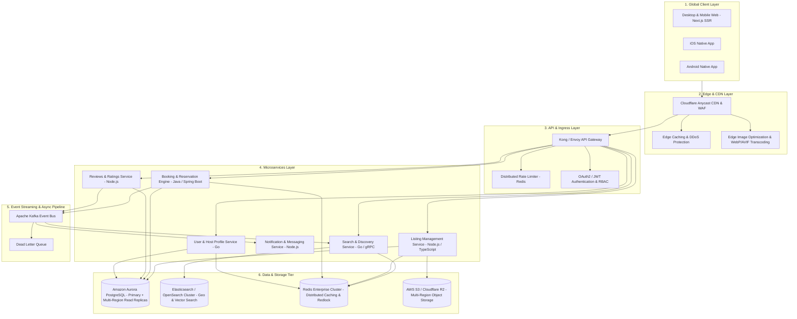

# Production-Scale Vacation Rental Marketplace Architecture
## System Architecture & Scaling Strategy

This document outlines the high-level system architecture and scaling strategy for an enterprise, production-scale vacation rental marketplace (similar to Airbnb) capable of handling millions of daily active users, global low-latency property searches, and high-concurrency booking reservations.

---

## 1. High-Level Architecture Diagram

---

## 2. Core Architectural Pillars

### A. Frontend Layer (Next.js & Edge Rendering)
- **Hybrid Rendering Architecture**:
  - **Incremental Static Regeneration (ISR)** for listing pages with high traffic to achieve near-instant TTFB (< 150ms globally).
  - **Client-Side Hydration (CSR)** for dynamic components such as real-time pricing, date availability, guest counts, and interactive modal overlays (Photo Tour and Lightbox).
  - **Edge Caching**: Stale-while-revalidate caching headers at Cloudflare CDN edge nodes.

### B. Global Search & Discovery Engine
- **Search Backend**: Distributed **OpenSearch / Elasticsearch** cluster.
- **Geo-Spatial Querying**: H3 hexagonal hierarchical spatial indexing for ultra-fast radius search (e.g., "Properties in Mandrem within 10km").
- **Vector Search / Semantic Embeddings**: Machine-learning embeddings (pgvector / OpenSearch k-NN) for amenity matching and personalized ranking.
- **Cache Invalidation**: Async CDC (Change Data Capture) via Debezium and Kafka to sync PostgreSQL updates to OpenSearch in < 200ms.

### C. Booking & Reservation Engine (Consistency & Concurrency)
- **Double-Booking Prevention**:
  - Distributed mutual exclusion lock using **Redis Redlock** during the checkout session lock window (10 minutes).
  - Transactional isolation: **Serializable isolation level** or pessimistic row-level locking (`SELECT ... FOR UPDATE`) in PostgreSQL on reservation commit.
- **Idempotency**: Client requests generate UUIDv4 idempotency keys stored in Redis to eliminate duplicate charges on network retries.
- **Saga Orchestration Pattern**: Orchestrates multi-step distributed transactions across Booking, Payment Gateway (Stripe), and Notification services with compensating rollback actions on failure.

### D. Asset Storage & Media Pipeline
- **Storage**: AWS S3 / Cloudflare R2 with cross-region replication.
- **Dynamic Optimization**: Next.js Image Optimization + Cloudflare Image Resizing automatically serves responsive WebP/AVIF formats based on device DPR and viewport.
- **Zero S3 Public Exposure**: Assets accessed strictly via Cloudflare CDN signed URLs and private origin access control (OAC).

### E. Scaling & Disaster Recovery Strategy
- **Kubernetes (EKS)** with Horizontal Pod Autoscaler (HPA) scaling microservices based on CPU, memory, and custom Prometheus request-rate metrics.
- **Aurora PostgreSQL Multi-Region**: Active-Passive setup with asynchronous cross-region replication for RPO < 1s, RTO < 5 minutes.
- **Multi-Zone Redis Cluster**: Redis Sentinel / Cluster mode with automatic failover across 3 Availability Zones.

---

## 3. High-Traffic Holiday Surge Strategy (10x Load)

| Component | Normal Traffic | 10x Surge Mitigation Strategy |
| :--- | :--- | :--- |
| **Listing Pages** | 50k req/min | 98% cached at CDN edge via Cloudflare Cache Reserve & Stale-While-Revalidate |
| **Search Queries** | 100k queries/min | OpenSearch read replicas autoscaled horizontally; hot search filters cached in Redis |
| **Booking Writes** | 5k checkout/min | Queue-backed checkout buffer (Kafka/SQS) with virtual waiting room during flash drops |
| **Database** | Aurora db.r6g.4xl | Read-write split: 1 Primary instance + 8 auto-scaling Read Replicas |
